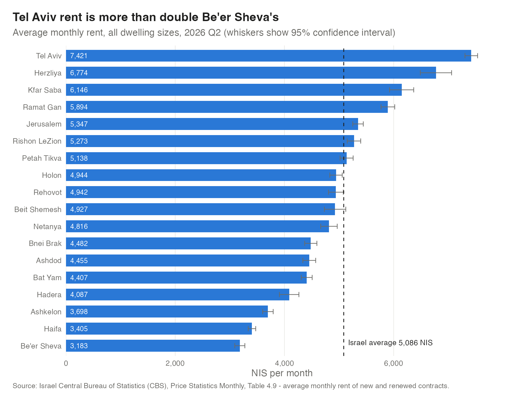
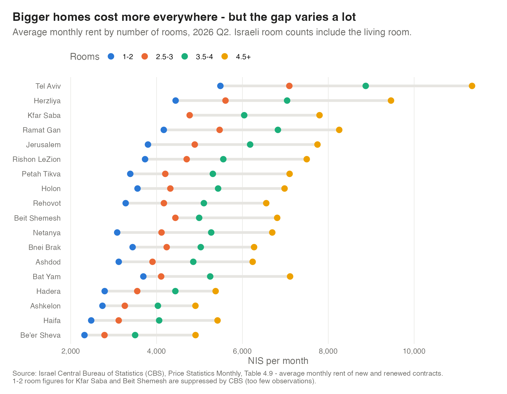
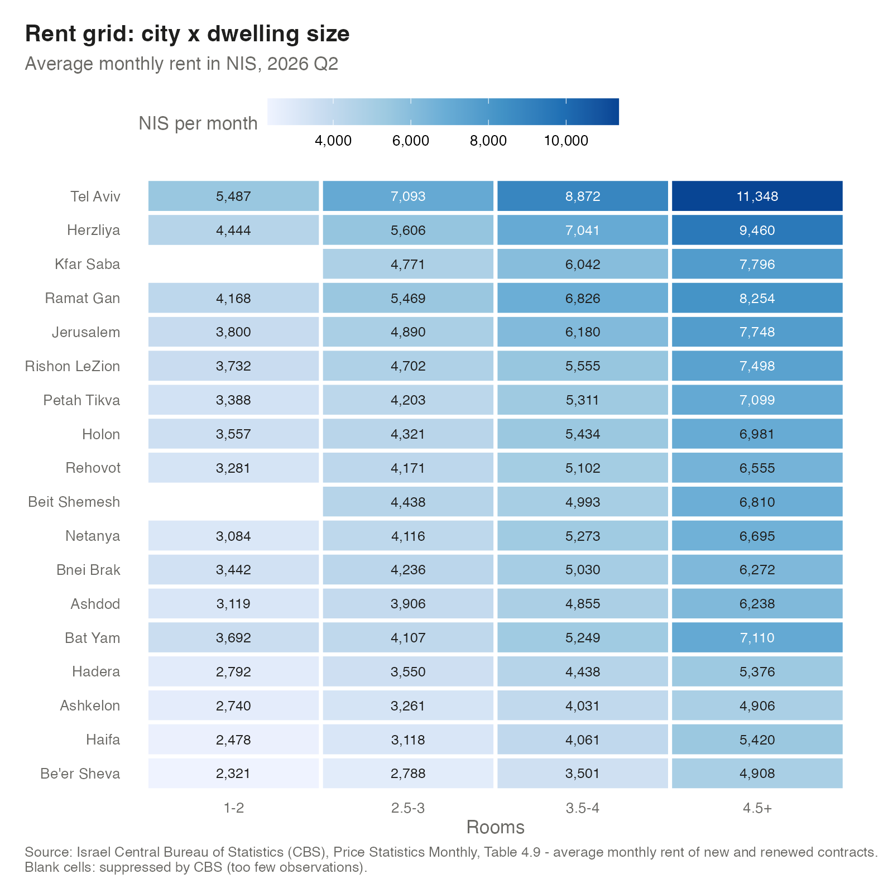
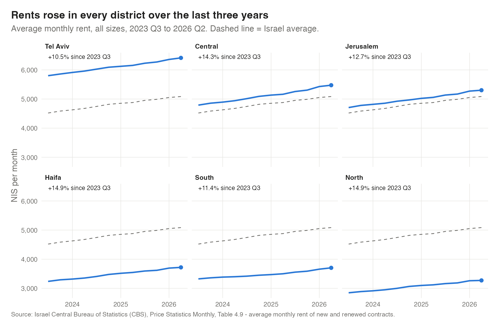
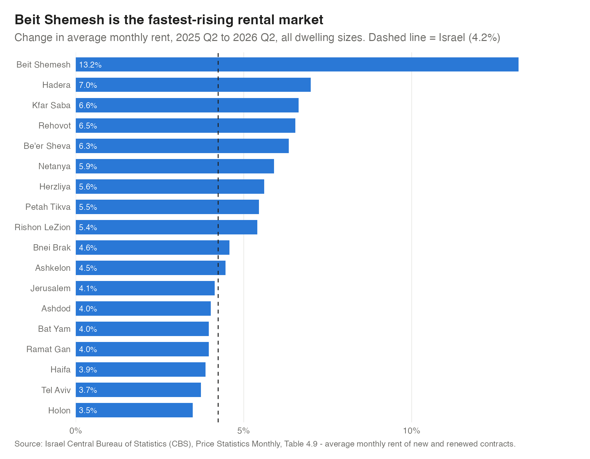
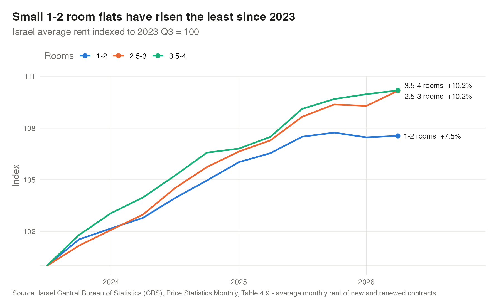

# Israel Rental Market Analysis

An analysis of rents across Israel's major cities, written in **R** with the **Tidyverse**, using official data from the Israel Central Bureau of Statistics (CBS).

The project looks at how monthly rent varies by **city**, **district** and **dwelling size**, and how prices have moved over three years, from Q3 2023 to Q2 2026.

**Tools:** R, Tidyverse (dplyr, tidyr, readr, stringr, forcats, lubridate), ggplot2, data visualisation

---

## Key findings

| | |
|---|---|
| **Israel average rent (Q2 2026)** | **5,086 NIS / month**, up 4.2% on a year earlier and 12.5% since Q3 2023 |
| **Most expensive city** | Tel Aviv, 7,421 NIS, which is 2.3x Be'er Sheva (3,183 NIS) |
| **Fastest-rising city** | Beit Shemesh, +13.2% in a year and +24.4% in three years |
| **Size premium** | A 3.5-4 room flat costs about 45% more than a 1-2 room flat (national average) |

1. **Location drives price more than anything else.** Even the cheapest size band in Tel Aviv (1-2 rooms, 5,487 NIS) costs more than a 3.5-4 room flat in 12 of the 18 big cities. Herzliya is second (6,775 NIS), ahead of Kfar Saba and Ramat Gan.
2. **The expensive centre is growing more slowly.** Over three years Tel Aviv (+9.7%) and Herzliya (+8.0%) rose the least of all big cities. The North and Haifa districts rose the most (+14.9% each), so the gap between the centre and the periphery is narrowing in percentage terms.
3. **Bigger homes are pulling away.** Nationally, 2.5-3 and 3.5-4 room flats both rose 10.2% since Q3 2023, against 7.5% for 1-2 room flats. Small-flat rents have been roughly flat since mid-2025.
4. **How much extra a bigger home costs depends on the city.** Moving from 1-2 to 3.5-4 rooms adds 71% in Netanya and 64% in Haifa, but only 42% in Bat Yam and 46% in Bnei Brak.
5. **Beit Shemesh is an outlier.** Its rents rose 13.2% in a year, three times the national rate, closing most of its gap with the national average (from 11% below to 3% below). It is now level with Holon and Rehovot.

---

## Charts

### Rent by city


### Rent by dwelling size




### Market trends






---

## Data

**Source:** Israel Central Bureau of Statistics, *Price Statistics Monthly*, Table 4.9: *Average Monthly Prices of Rent (NIS), by Residential District, Big Cities and Size Group (Rooms)*.

- **Coverage:** Israel overall, 6 residential districts and 18 big cities (over 100,000 residents)
- **Size bands:** 1-2, 2.5-3, 3.5-4 and 4.5+ rooms (Israeli room counts include the living room)
- **Period:** 12 quarters, Q3 2023 to Q2 2026
- **Measures:** average monthly rent (NIS) and CBS sampling error

Each CBS edition only covers seven quarters, so five editions were combined, keeping the most recent published value for each quarter. Download links and CBS notes are in [`data/raw/SOURCES.md`](data/raw/SOURCES.md).

## Method

1. **Clean and reshape** ([`R/01_clean_data.R`](R/01_clean_data.R)): pivot the wide CBS layout (one column per quarter) into tidy long format with `pivot_longer()`, standardise city names, harmonise the 4.5+ size band (CBS renamed and redefined it in 2026), build proper quarter dates, and run sanity checks (no duplicate keys, 12 quarters, positive rents).
2. **Analyse and visualise** ([`R/02_analysis.R`](R/02_analysis.R)): compare cities and districts in the latest quarter, add 95% confidence intervals from CBS sampling errors, calculate year-on-year and three-year growth, index rents to a common base to compare size bands, and calculate the size premium in each city.
3. **Outputs:** six charts in [`figures/`](figures/) and summary tables in [`output/`](output/).

## Run it yourself

Requires R (4.1 or later) and the `tidyverse` and `scales` packages.

```r
install.packages(c("tidyverse", "scales"))
```

From the project folder:

```bash
Rscript run_all.R
```

## Project structure

```
israel-rental-market/
├── data/
│   ├── raw/            # CBS Table 4.9 extract + source notes
│   └── processed/      # tidy long-format data
├── R/
│   ├── 01_clean_data.R
│   └── 02_analysis.R
├── figures/            # charts (PNG)
├── output/             # summary tables (CSV)
└── run_all.R
```

## Caveats

- CBS averages cover new and renewed contracts, so part of any change between quarters comes from a shift in which homes were rented, not only from price changes.
- From Q1 2026 the 4.5+ band includes homes with more than 6 rooms, so the 4.5+ figures for 2026 are not directly comparable with earlier quarters. That band is left out of the growth-by-size chart.
- Three years is a short window, so these figures describe recent trends rather than the long-run market.

*Data © Israel Central Bureau of Statistics, used with attribution.*
